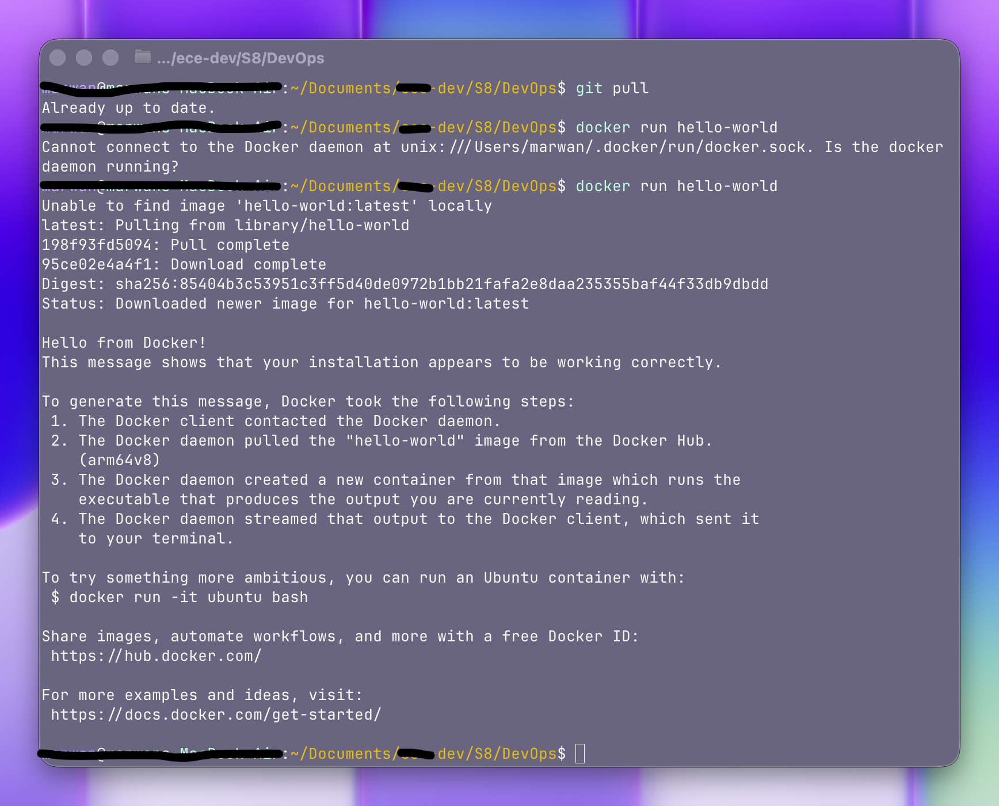
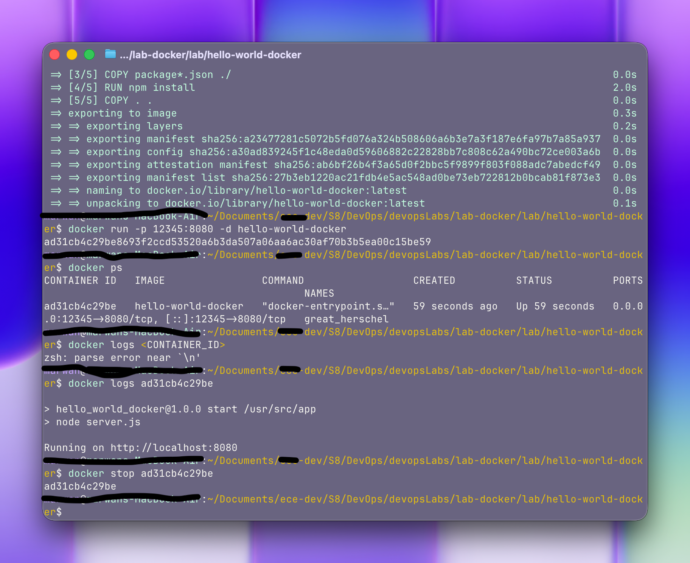
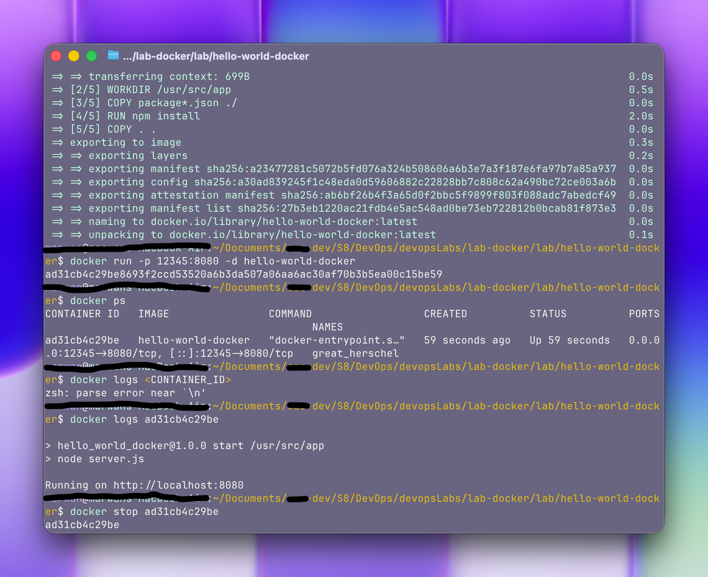
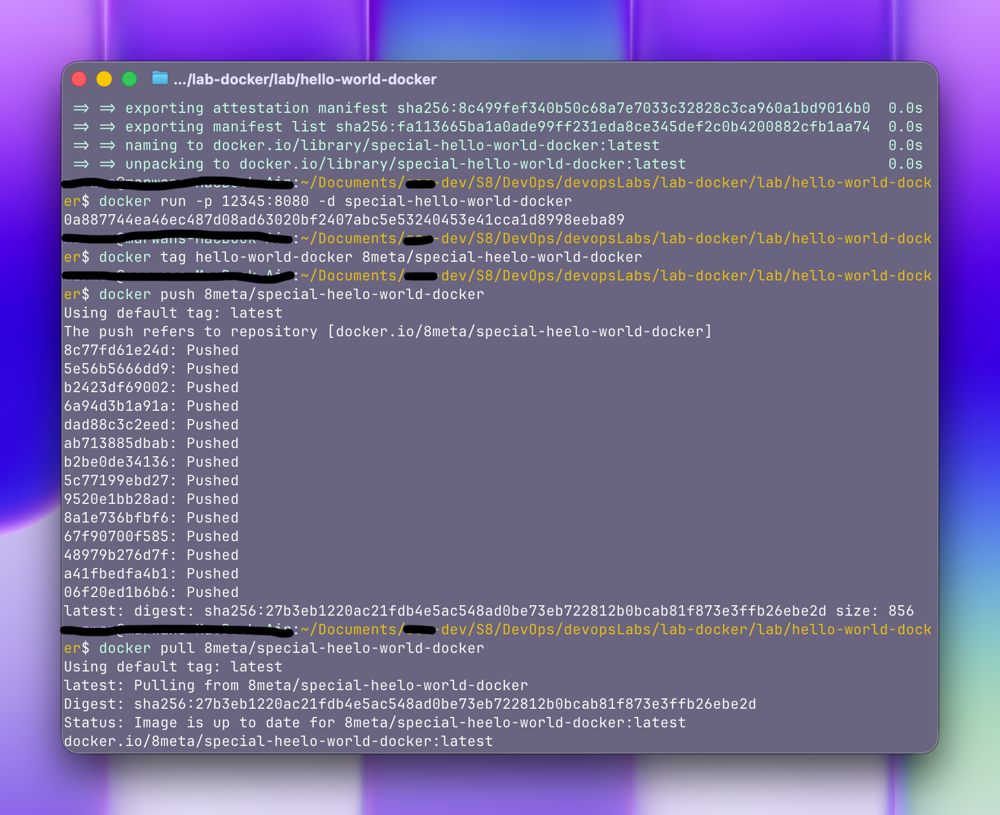
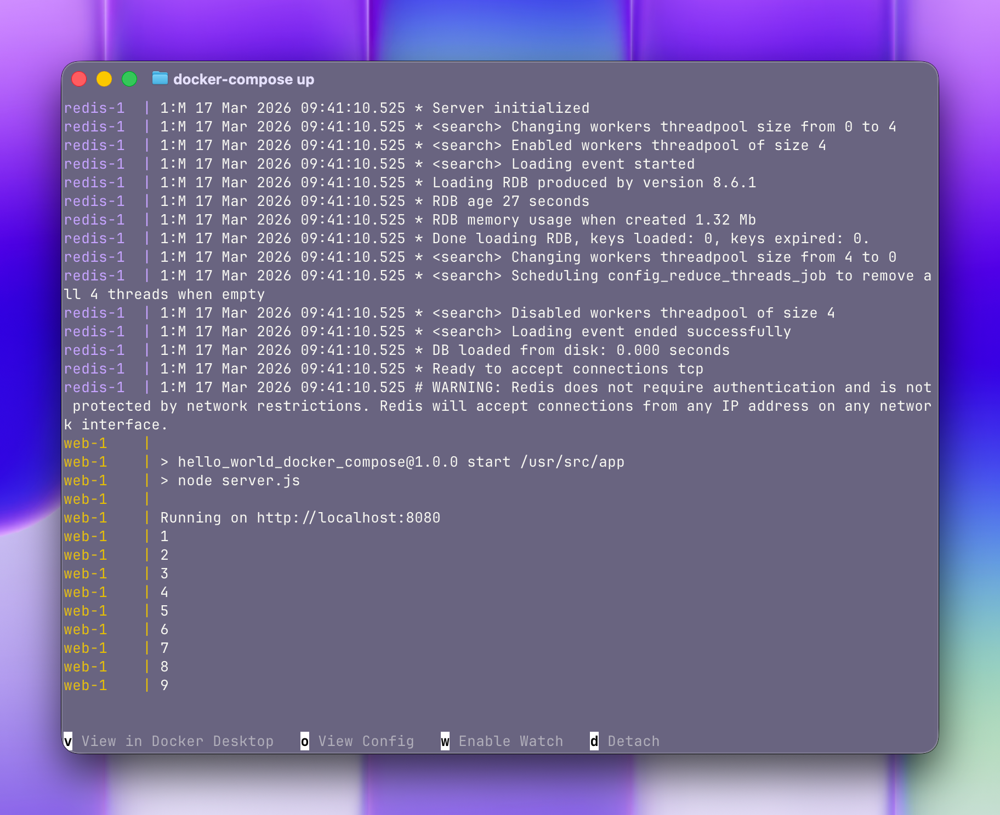

# Lab Containers with Docker

## ## 1. Install Docker

## 2. Write a Dockerfile and build a Docker image

dockerfile available in the directory 'hello-world-docker'

## 3. Run a Docker container with multiple options

## 4. Share your Docker container

## 5. Build and run a multiple container app with Docker Compose

Writing docker-compose.yml was a real challenge and need me to understand ports and knowing each depencies of services.

code available in the directory 'hello-word-docker-compose'

