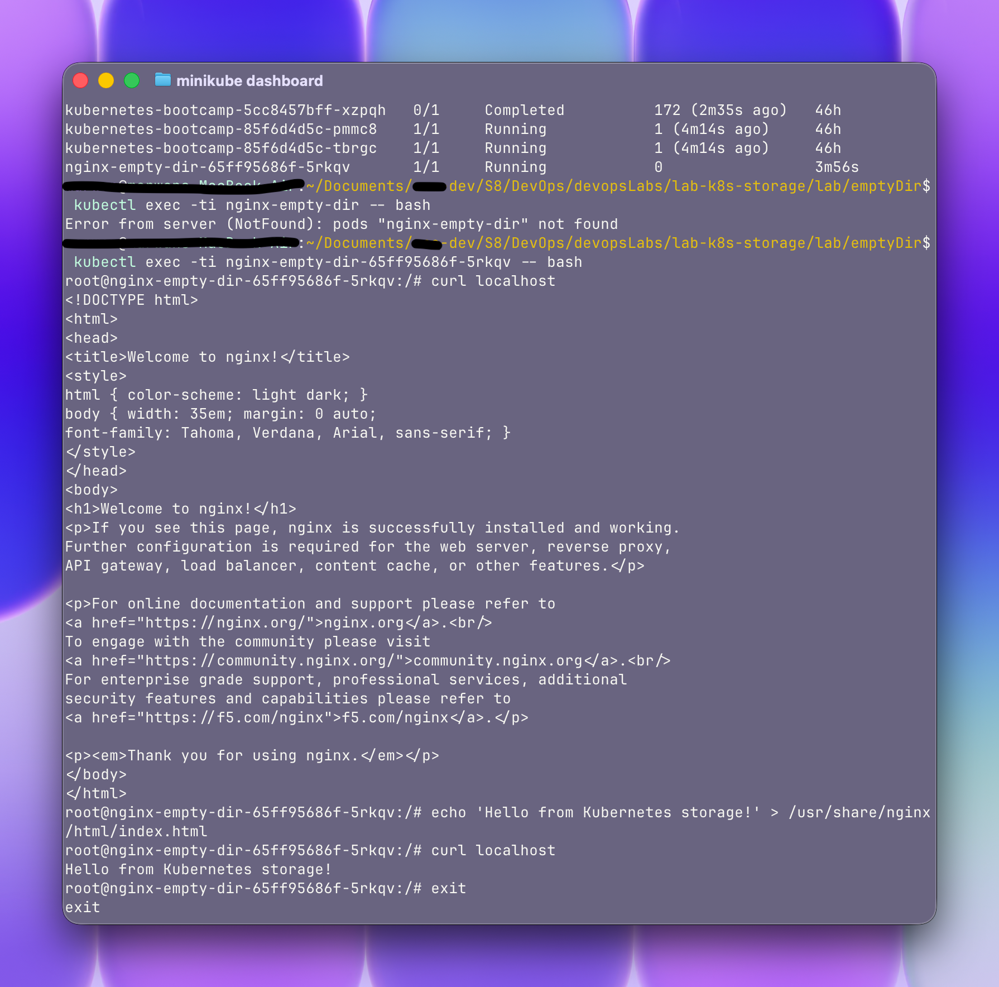
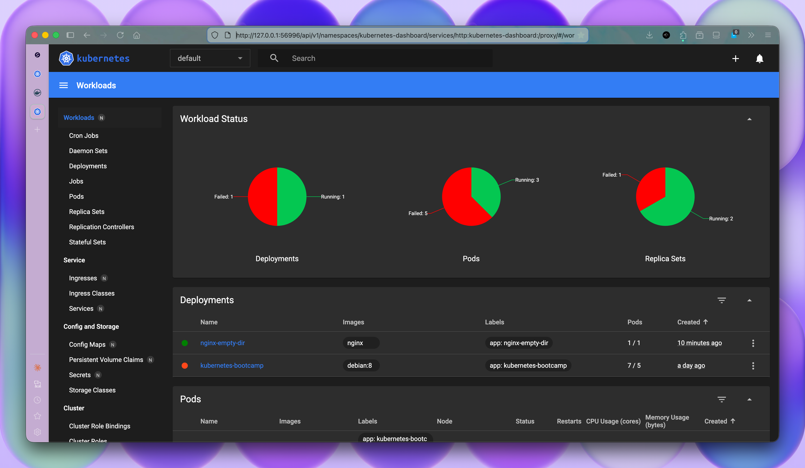
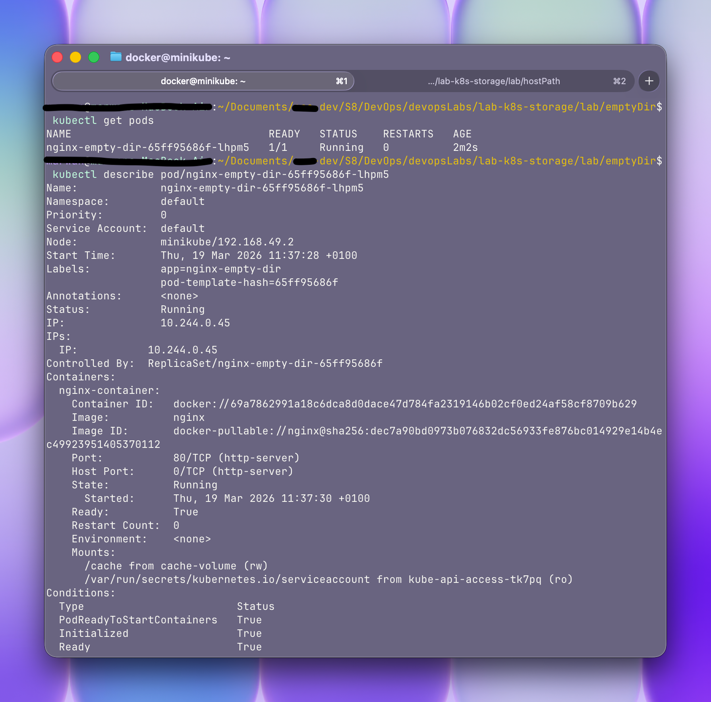
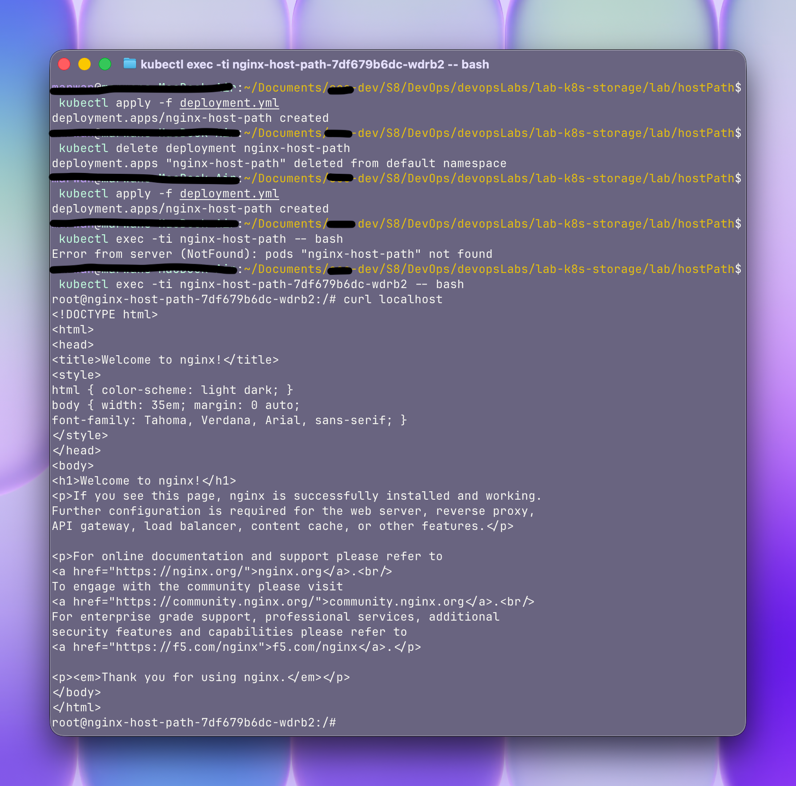
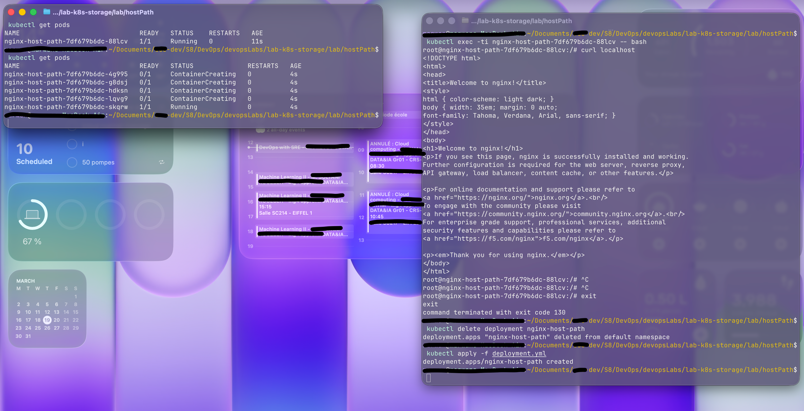
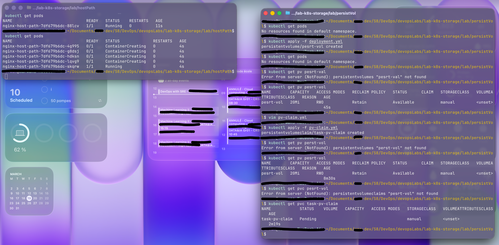
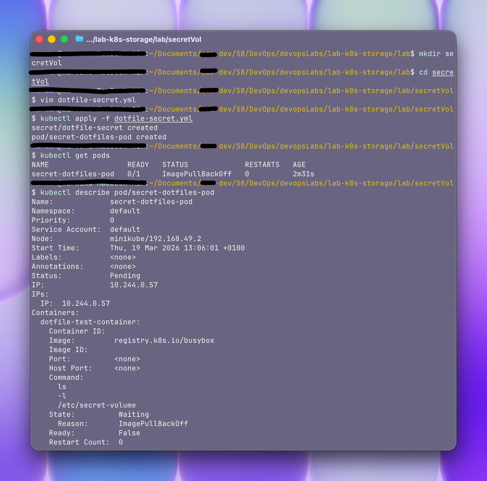
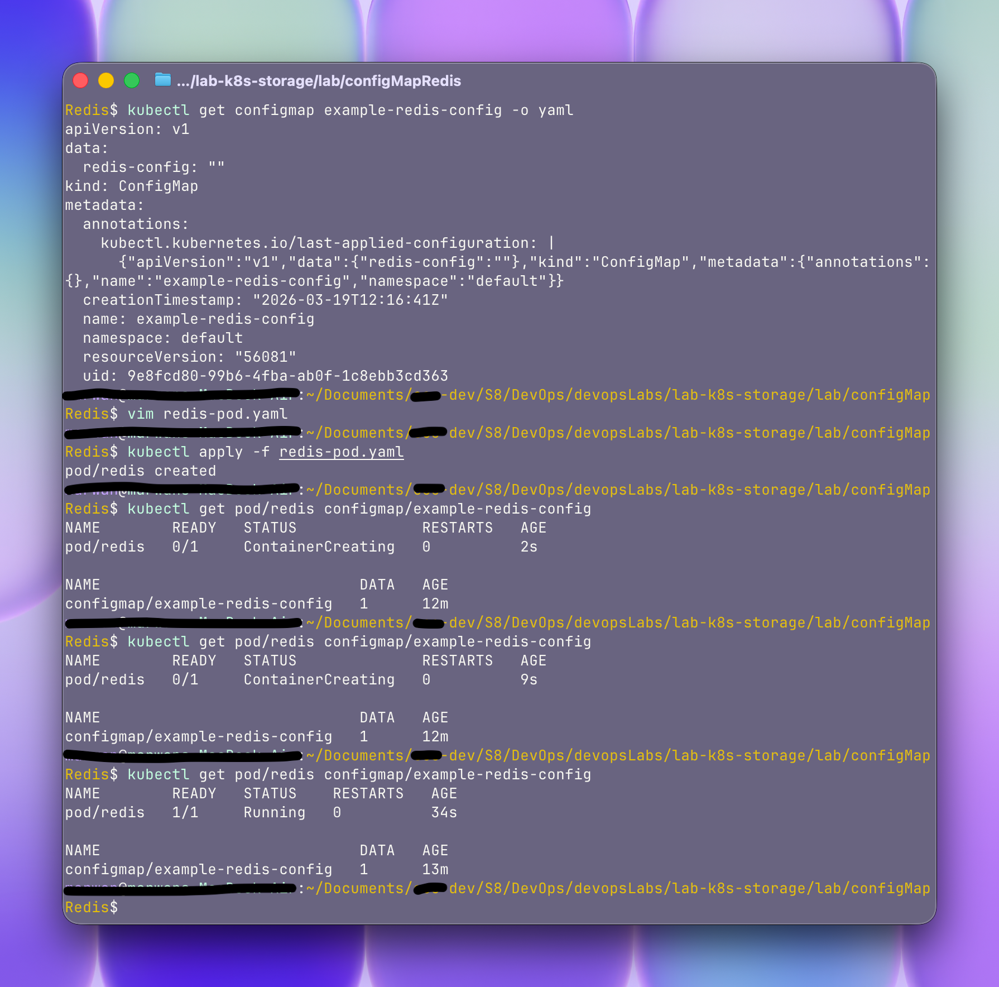

# ## Lab

## 1. Use `emptyDir` storage

```bash
# 1️⃣ Start a Docker container running Nginx
docker run -d --name nginx‑svc nginx:latest

# 2️⃣ Launch a local Kubernetes cluster with Minikube
minikube start

# 3️⃣ Deploy the manifest that creates the Nginx pod
kubectl apply -f <your‑manifest>.yaml

# 4️⃣ Open an interactive shell inside the newly created pod
kubectl exec -it nginx‑empty‑dir-65ff95686f-5rkqv -- /bin/bash
```







## 2. Use `hostPath` storage






## 3. Use PersistentVolume



## Bonus tasks

Secret volume



ConfigMap



## Bilan

- A possible application int he real world of storage in kubernetes is deploying an infrastructure with an optimize infrastructure based on persistent and ephemeral storage. Being able to handle storage persistance with ease or almost automatically is a break-through. For example, a queue storage type can be mounted to handle an overload of queries of a SaaS.

- This is Build, deployment and scale phases. Kurbernetes give access to handling these phases with ease.

- This is not a difficulty but some tasks that take a little bit more time than expected. Knowing the syntax can be time-consuming, whilst, without doubt, after knowing it, it will be pleasant.

- Building several types of file. Understanding and coding YAML. Getting experience with IaC. Benefit of ease using kubernetes. K8s is a tremendous system.
