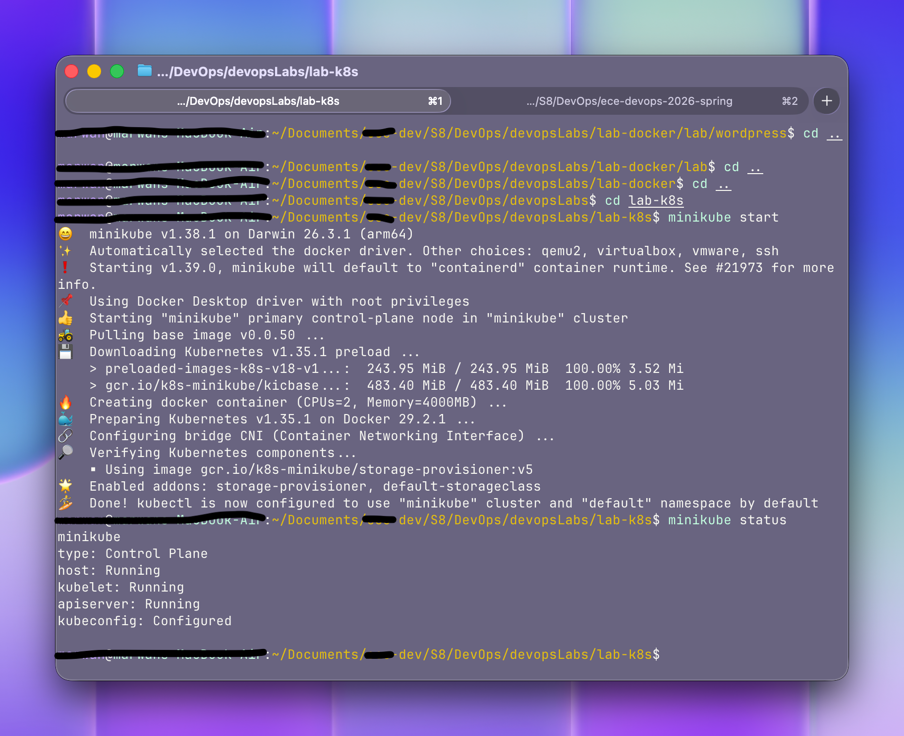
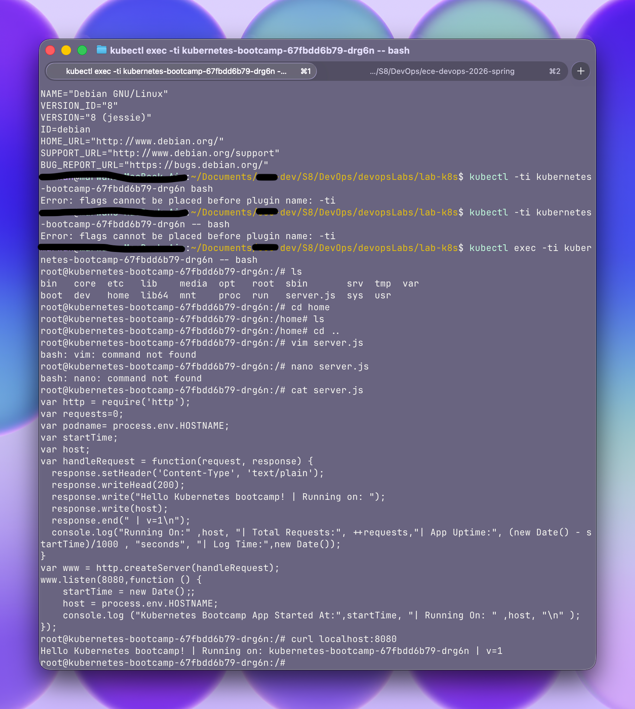
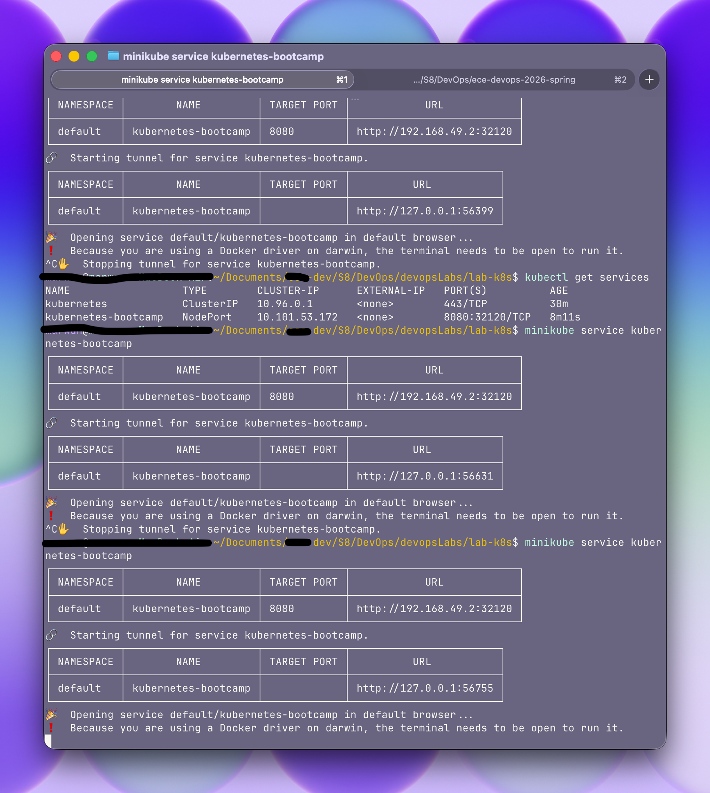
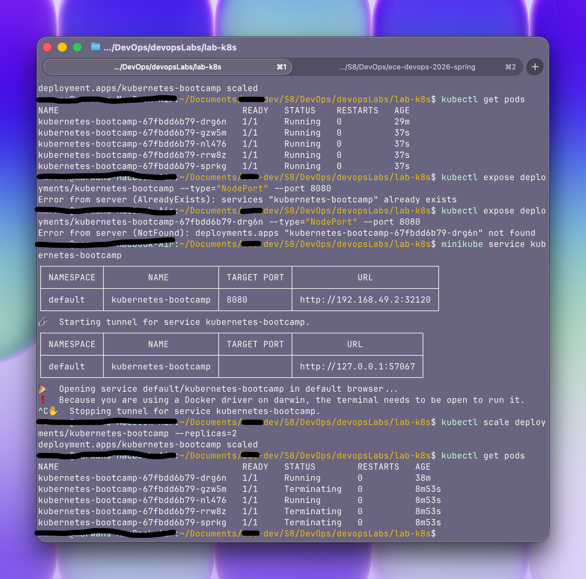
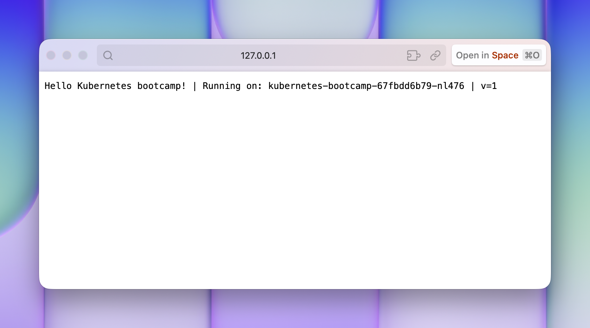
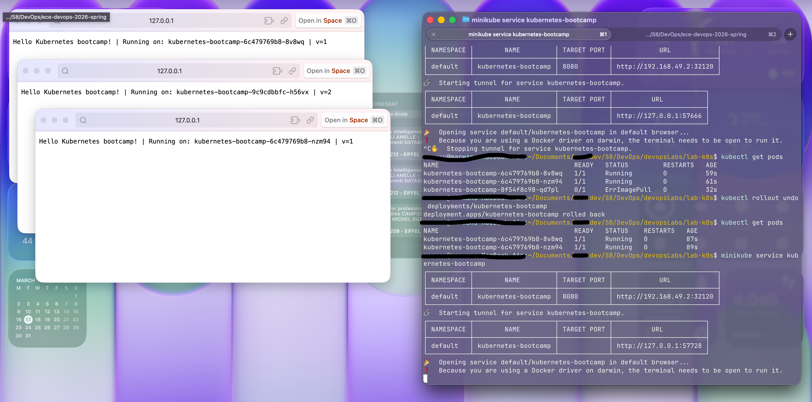
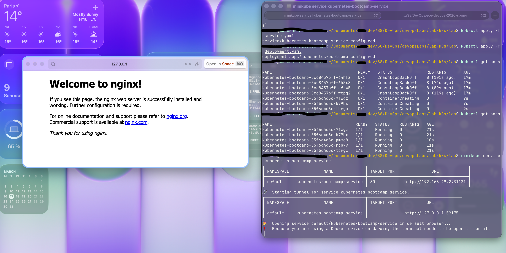

# Lab

## 1. Install Minikube

## 2. Learn to use `kubectl` commands

My pod name is kubernetes-bootcamp-67fbdd6b79-drg6n

I'm not able to query the pod's server.

## 3. Learn to expose a Kubernetes service to the outside

## 4. Learn to scale up and down a Kubernetes deployment

A load balancer manage redirection. As you can see, it redirect me to one of the pods

## 5. Run a multiple pod application in Kubernetes

## 6. Deploy an app using Manifest yaml files

Files are available in 'lab' sub-folder.

## Bilan

Possible applications are to build and deploy a SaaS on the web.

Kubernetes corresponds to the build, deployment, and scale phases because it handles different platforms to support software code. It can replicate with ease.

The lab allowed us to get an advanced understanding and pratice of such a fundamental systems of nowadays.

Tasks that take a little bit more time than expected. There are :

- Differencing minikube and kubectl

- Understanding that kubernetes was using a LoadBalancer
