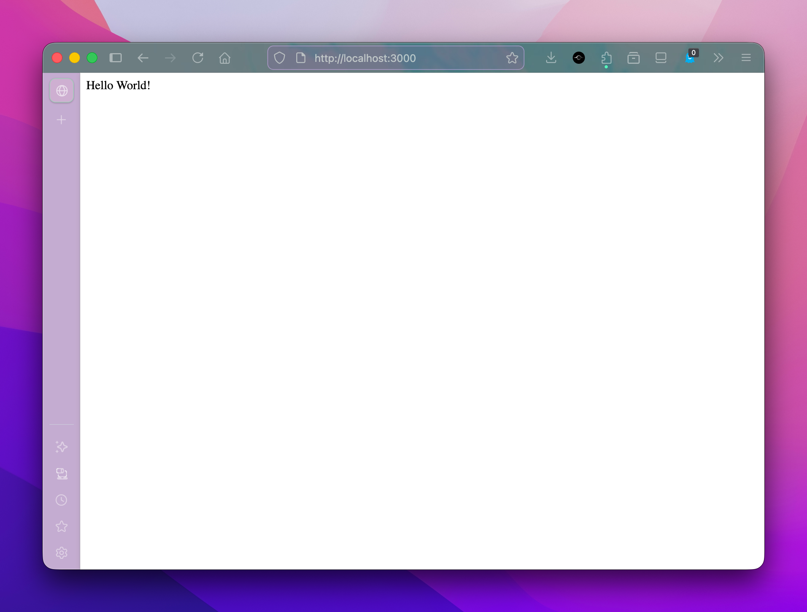
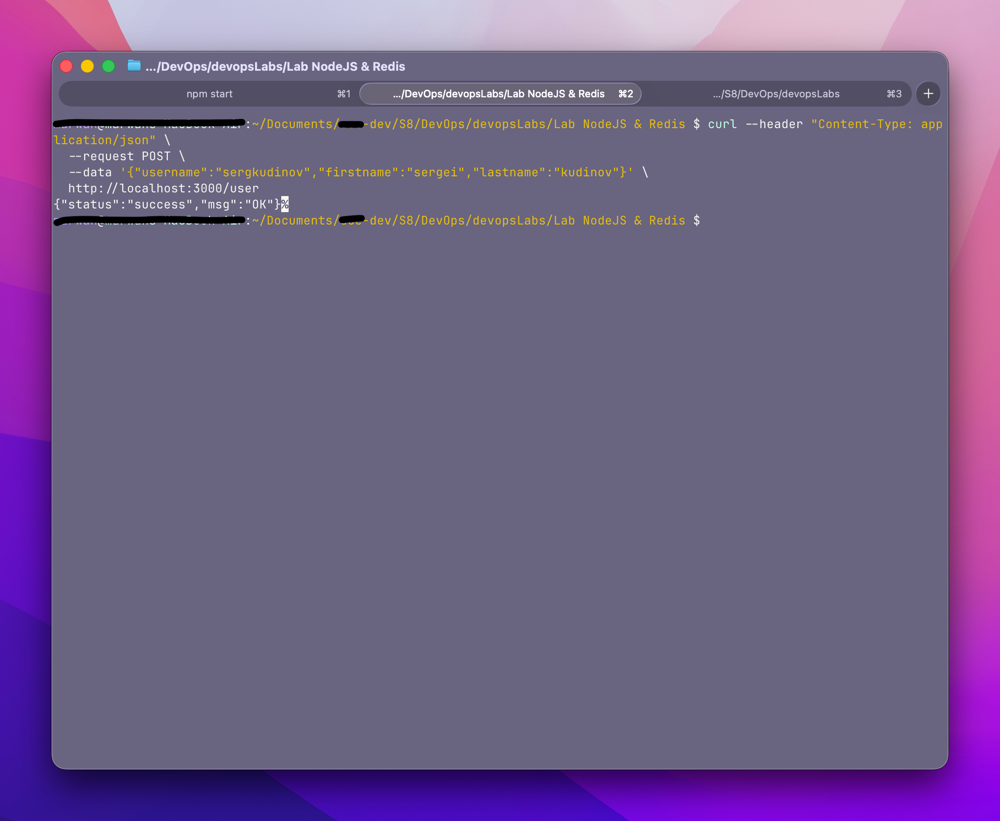
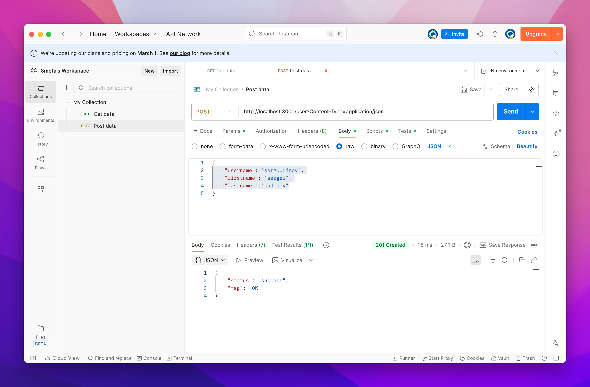
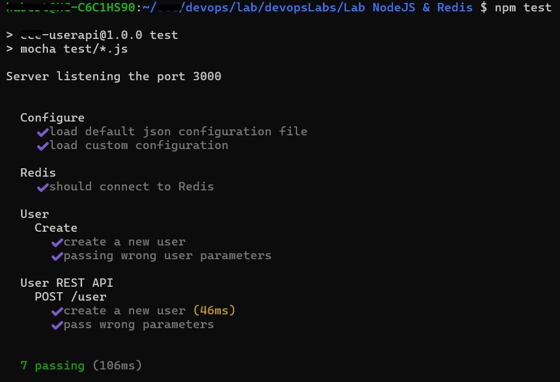
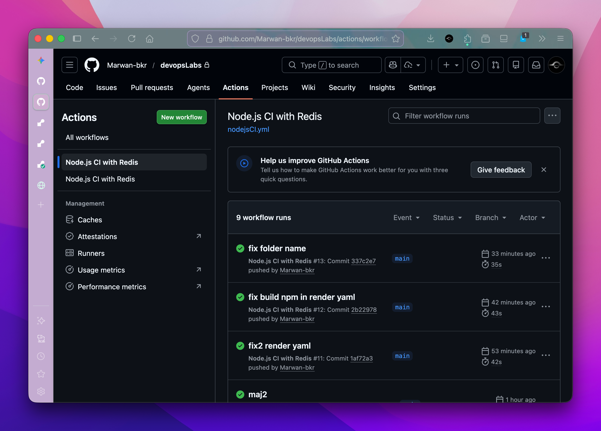
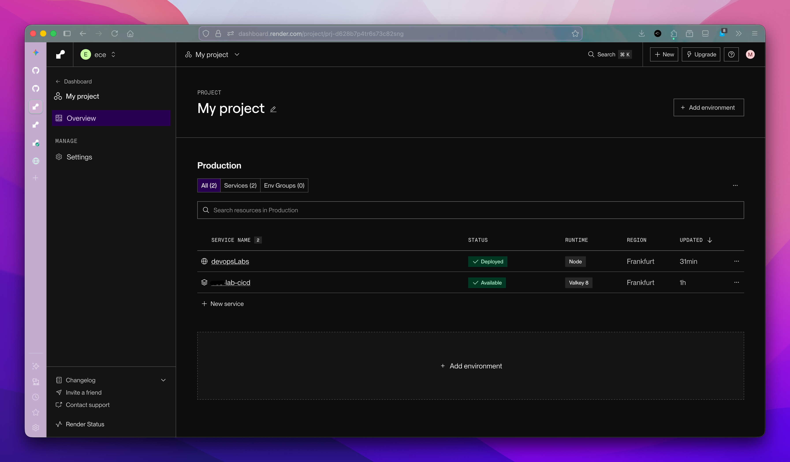
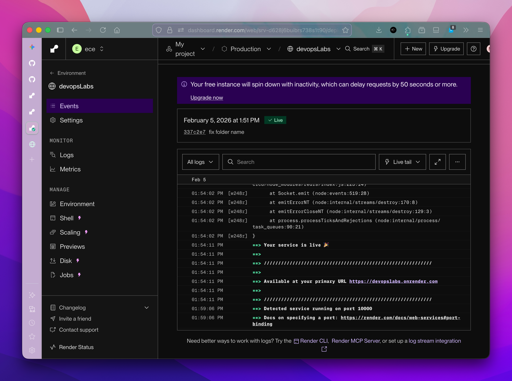
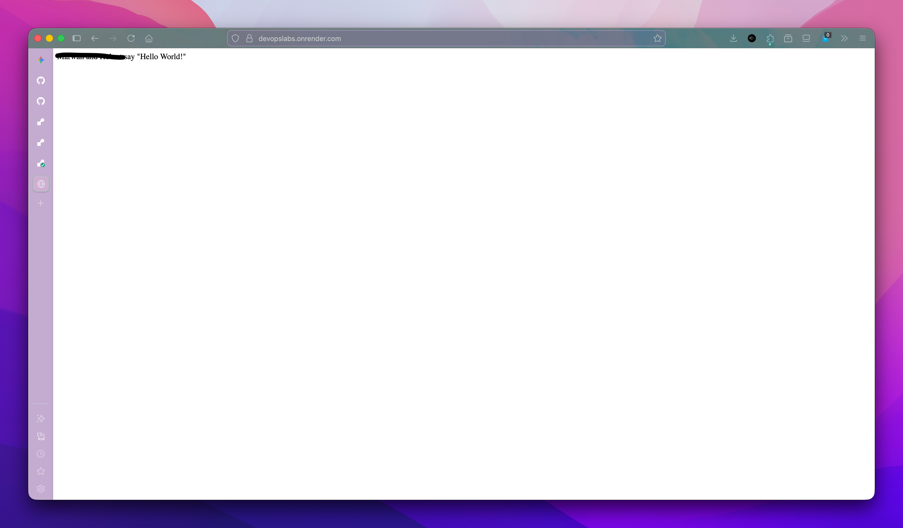
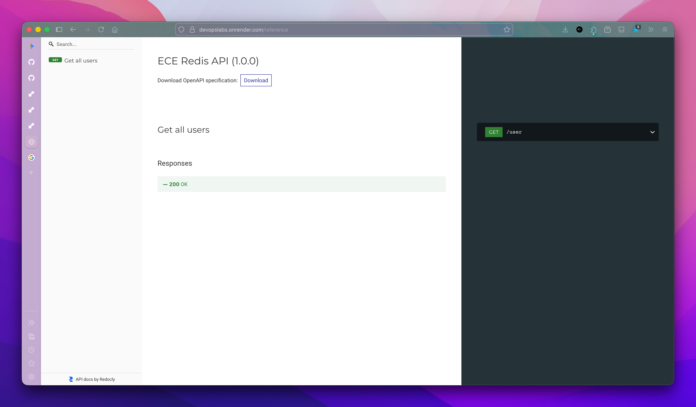

# DevOps with SRE

## Lab Node & Redis

**Github**

First, we had an issue with github branches on how to locate the origin of a new branch and how to handle branch management. 

We use commands like :

- git checkout

- git branch

- git push --set-upstream

- git branch -r

- git branch -a

The result is one branch main, a second branch dev and one personal branch each. One branch each because we use different OS (macOs, Windows) and to complete the lab different software and method were used.

**Installation**

Installations was completed without issue on macOs whilst WSL (WindowsSubsystemforLinux) was needed on the way to run all the lab in a linux environment.

**Usage**

After a few errors of ports and missing Redis services, the web page worked perfectly.

**Testing**

## Lab CI/CD

### Part 1. Continuous Integration with GitHub Actions

We don't have difficulty to implement Github Actions except with two configuration.

- The lab is in a subfolder of the repo

- The folder of the lab raise errors from sensitive software

So we can say that Github Actions is a little bit sensitive to special character, space, etc. We just need to specify working-directory.

### Part 2. Continuous Delivery (Deployment) with ~~Heroku~~ Render

The setup of render was pretty soft. The main difficulties encountered was with subfolder app, the complex name of the app folder and running npm on the way to build in render.

After many attempts, we finally decide to give up complex folder name. From "Lab NodeJS & Redis " to "lab-nodejs-redis-cicd".

Even with specification of subfolder name containing the app during Render setup, we had to manually change "Root Directory" value.

Then, the remote build of the app needed to correct "Build Command" from "npm" to "npm install".

 

Redis database was easier to setup than web service. Notably, we had to clear cache many times to ensure no such source of error.

Click here to access it : https://devopslabs.onrender.com/

### Bonus tasks

No difficulty to implement Swagger UI except finding to safer way to implement it because of deprecated documentation.

I have installed swagger ui in the wrong folder causing error.

Swagger is an ESM-only which is incompatible with build 18.x. So I switch to redoc-express

Click here to access it : https://devopslabs.onrender.com/reference

Because of time we don't take the time to properly manage the project using full capabilities of github like branch for example. It's a matter of habit.

## Bilan

- Possible application to build a Saas.
- Taking time to conceive the solution is essential to not enter in an endless cycle of debugging. So we take time to review the code, optimise functions and correct errors before pushing and building. We used to use AI chatbots, but giving the full context is something difficult.
- Yes, we understand how to automate integration and deployment on the way to becoming better developers. Tests are an essential competence to master.
